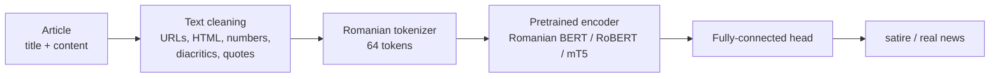

# Romanian Satire Detection · Nitro NLP 2024

[](https://www.python.org/)
[](https://pytorch.org/)
[](https://huggingface.co/docs/transformers)
[](https://www.kaggle.com/competitions/nitro-language-processing-3)

Our team's solution to the **[Nitro Language Processing Hackathon, 3rd edition](https://www.kaggle.com/competitions/nitro-language-processing-3)** (March 2024): a transformer-based classifier that tells **satirical** Romanian news articles apart from **real** ones. Four students built it in a 23-hour Kaggle competition.

🏅 **Honorable Mention** · 10th of 45 teams on the final leaderboard (balanced accuracy 0.9375)

**→ [Open the annotated notebook](nitro-nlp-2024.ipynb)**

## Highlights

- **Automated text cleaning for raw Romanian news.** Regular expressions strip URLs, HTML tags and numbers, and the Romanian diacritics (cedilla `ş ţ` → comma-below `ș ț`), typographic quotes and dashes are normalised.
- **Dataset and tokenizer classes for Romanian-specific encoders** (RoBERT, Romanian BERT and Romanian mT5), applied to each article's headline and body concatenated into one input.
- **PyTorch classifiers built on pretrained transformer encoders**, with custom fully-connected heads on the text embeddings, a utility for targeted layer unfreezing, and a class-weighted loss suited to the balanced-accuracy metric.

## The hackathon

Nitro NLP is a natural language processing hackathon for students in Romania. The 3rd edition ran as a Kaggle competition with a **23-hour submission window**, from 30 March 10:00 to 31 March 10:00 (EET). The results were announced at the team presentations that followed.

- Teams of 2–4 high-school or bachelor's students. 45 teams and 147 participants made 855 submissions in total.
- No external data or data augmentation, no LLM APIs and no models with more than 1 billion parameters. Pretrained models such as BERT were allowed.
- Each team submitted its code at the end, and the code had to reproduce the selected submissions exactly (fixed random seeds).

## The task

Binary classification of Romanian news articles into **satire (1)** and **real news (0)**. The dataset was collected from a mix of real and composed news articles.

| File | Content |
|---|---|
| `train.csv` | about 70,600 labelled articles: `title`, `content` and the label |
| `test.csv` | about 36,700 unlabelled articles: `title` and `content` |

Either field can be empty, and `content` is sometimes only the first paragraph of the article.

Submissions are scored with **balanced accuracy**, the mean recall over the two classes, which keeps a model from scoring well by favouring the more frequent class:

$$\text{Balanced accuracy} = \frac{1}{2}\left(\frac{TP}{TP + FN} + \frac{TN}{TN + FP}\right)$$

The final ranking comes from the private leaderboard, which is computed on about 30% of the test set.

## Our approach



1. **Cleaning.** Rows containing tab characters are dropped. Regular expressions remove URLs, HTML tags and numbers, and repeated whitespace is collapsed. Legacy cedilla letters (`ş ţ Ş Ţ`) are mapped to the correct comma-below forms (`ș ț Ș Ț`) so that the same word always produces the same tokens. Typographic quotes become plain quotes, and soft hyphens and dashes are removed. We also tried stripping punctuation, e-mail addresses and click-bait words (`ȘOC`, `BREAKING NEWS`, ...), but those steps did not make the final pipeline.
2. **Tokenisation.** The headline and the body are concatenated and tokenised to 64 tokens with the tokenizer of the encoder being trained: [Romanian BERT](https://huggingface.co/dumitrescustefan/bert-base-romanian-cased-v1), [RoBERT](https://huggingface.co/readerbench/RoBERT-base) or [Romanian mT5](https://huggingface.co/dumitrescustefan/mt5-base-romanian).
3. **Model.** The pretrained encoder produces a text embedding: the pooled `[CLS]` vector for BERT and RoBERT, or all token vectors flattened for mT5. A custom fully-connected head classifies that embedding; for Romanian BERT it is `Linear(768→512) → GELU → Linear(512→2)`. An `unfreeze()` utility selects which encoder layers are trained.
4. **Training.** Cross-entropy weighted by `1 − class share` (the rarer class counts more), AdamW with learning rate 2e-5 and weight decay 5e-6, batch size 64, 3 epochs, seed 61.
5. **Inference.** The arg-max over the two logits gives each test article's label, written to `submission.csv`.

## Results

Our team, **Multiplying Tensors**, received an **Honorable Mention** at the hackathon.

| Leaderboard | Balanced accuracy | Rank |
|---|---|---|
| Public | 0.9389 | 9 / 45 |
| **Private (final)** | **0.9375** | **10 / 45** |

The run in the notebook (Romanian BERT, about 6.5 minutes per epoch on a Kaggle GPU) reaches a training balanced accuracy of 0.997 after three epochs. The gap between that and the leaderboard score is the clearest sign of overfitting. The notebook ends with what we would try next: a local validation split, longer inputs, a partly frozen encoder and an ensemble of the three encoders.

## Repository contents

| File | Description |
|---|---|
| [`nitro-nlp-2024.ipynb`](nitro-nlp-2024.ipynb) | The full pipeline in documented sections: data, cleaning and tokenisation, dataset, models, training, inference, results |
| [`requirements.txt`](requirements.txt) | Python dependencies |

The notebook was reorganised and commented after the hackathon, and the changes are listed at the end of it. The unmodified notebook exported from Kaggle, with its complete training log, is in the [first commit](https://github.com/Mejayyy/nitro-nlp-2024/blob/3a4f0c974143276d81516f82fc06da7fac650b17/nitro-nlp-2024.ipynb).

## Running the notebook

**On Kaggle (easiest).** Create a notebook, attach the data via *Add Input → Competitions → Nitro Language Processing - 3rd Edition - Satire*, turn on a GPU accelerator, then import `nitro-nlp-2024.ipynb` and run all cells. Training takes about 20 minutes, and `submission.csv` is written to the working directory. The competition still accepts late submissions, so you can score the output.

**Locally.** You need Python 3.10+ and preferably a CUDA GPU. Downloading the data requires a Kaggle account that has accepted the competition rules.

```bash
pip install -r requirements.txt
kaggle competitions download -c nitro-language-processing-3
unzip nitro-language-processing-3.zip -d data
```

Then set `DATA_DIR = Path('data')` in the configuration cell. `MODEL_NAME` selects the encoder (`'bert'`, `'RoBERT'` or `'mt5'`).

The competition data is licensed CC BY-NC-SA 4.0 and is not included in this repository.

## Team

**Multiplying Tensors**

- Mihai-Radu Tătaru ([Kaggle](https://www.kaggle.com/mihaitataru))
- Radu-Tudor Vrinceanu ([Kaggle](https://www.kaggle.com/radutudorvrinceanu))
- Sandor Cristian ([Kaggle](https://www.kaggle.com/crs100))
- Jany-Gabriel Ispas ([Kaggle](https://www.kaggle.com/janygabrielispas))

## Acknowledgements

- The Nitro NLP organisers for the competition and the dataset: Cristi Bleotiu, Lucian Istrati, Miruna-Andreea Zavelca and Nitro NLP, *[Nitro Language Processing - 3rd Edition - Satire](https://www.kaggle.com/competitions/nitro-language-processing-3)*, Kaggle, 2024.
- The authors of the pretrained Romanian encoders: [Romanian BERT](https://huggingface.co/dumitrescustefan/bert-base-romanian-cased-v1) and [Romanian mT5](https://huggingface.co/dumitrescustefan/mt5-base-romanian) by Ștefan Dumitrescu et al., and [RoBERT](https://huggingface.co/readerbench/RoBERT-base) by ReaderBench (Masala et al.).
